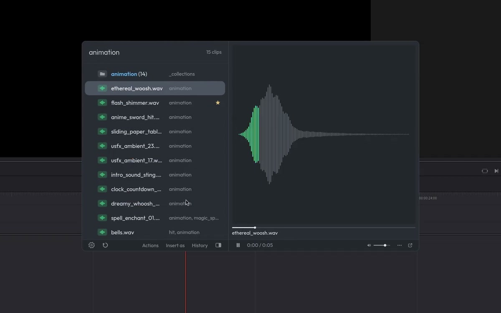

<div align="center">
  
  <h1>Clipse</h1>
  <p>A quick search for DaVinci Resolve Studio.</p>
  <p>
    <a href="https://alnor.store/clipse.html">Website</a> &nbsp;·&nbsp;
    <a href="https://alnor.store/docs.html">Documentation</a> &nbsp;·&nbsp;
    <a href="https://github.com/alnor0/clipse/releases">Releases</a>
  </p>
  
</div>

<br>

Type a few letters, press Enter and it's on your timeline. Clipse finds your clips, sounds, markers, scripts, macros and Fusion nodes, plays them before you insert them, and lets you decide how they land.

## Install

```sh
curl -fsSL https://downloads.alnor.store/install.sh | sh
```

Clipse needs DaVinci Resolve Studio, with Preferences › System › General › External scripting using set to Local. Then open it from Workspace › Scripts › !Clipse › Clipse - Open, and give it a key in Resolve's Keyboard Customization.

It's made and tested on Linux. [Mac and Windows builds](https://github.com/alnor0/clipse/releases) are made automatically and aren't tested, so they may not work.

## Privacy

Clipse checks alnor.store for updates and sends crash logs there, which hold clip names. Both can be turned off in Settings › About. Nothing else leaves your computer unless you send feedback.

## License

[GPL-3.0](LICENSE). Clipse is an independent tool, not affiliated with Blackmagic Design.
