<div align="center">
  
  <h1>Clipse</h1>
  <p>A quick search for DaVinci Resolve Studio.</p>
  <p>
    <a href="#install">Install</a> &nbsp;·&nbsp;
    <a href="docs/guide.md">Guide</a> &nbsp;·&nbsp;
    <a href="https://github.com/alnor0/clipse/releases">Releases</a>
  </p>
  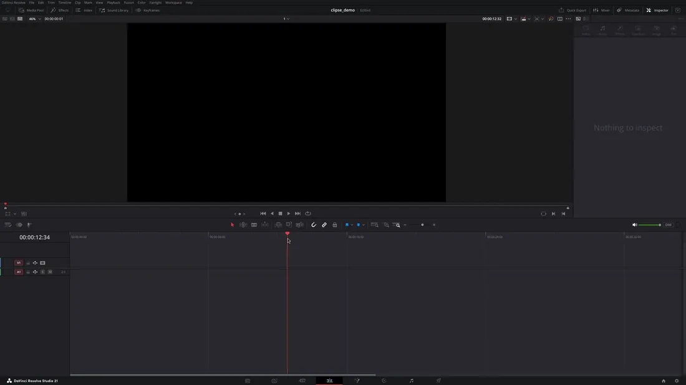
</div>

<br>

Type a few letters, press <kbd>Enter</kbd> and it's on your timeline. Clipse finds your clips, sounds, markers, scripts, macros and Fusion nodes, plays them before you insert them, and lets you decide how they land.

## Install

```sh
curl -fsSL https://downloads.alnor.store/install.sh | sh
```

Clipse needs DaVinci Resolve Studio, with Preferences › System › General › External scripting using set to Local. Then open it from Workspace › Scripts › !Clipse › Clipse - Open, and give it a key in Resolve's Keyboard Customization.

It's made and tested on Linux. [Mac and Windows builds](https://github.com/alnor0/clipse/releases) are made automatically and aren't tested, so they may not work.

## What it does

### Find anything fast

Start with a prefix to search only scripts, markers or sounds. <kbd>Tab</kbd> picks a few at once, and <kbd>Ctrl</kbd>+<kbd>Tab</kbd> picks the same one twice.

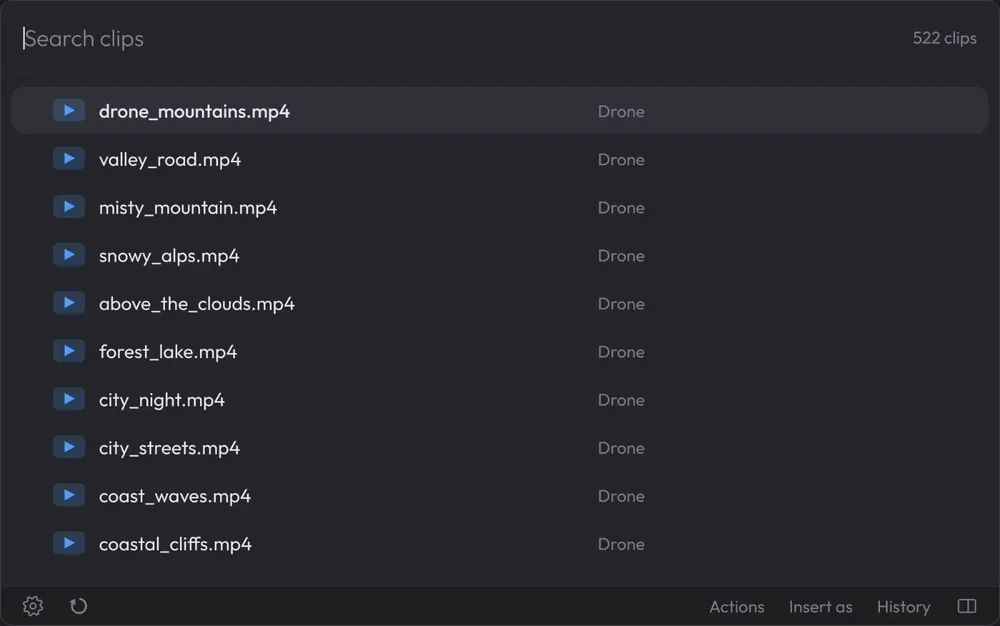

### See and hear it first

Every clip plays right next to the list, with <kbd>Ctrl</kbd>+<kbd>Shift</kbd>+<kbd>P</kbd>. With <kbd>Ctrl</kbd>+<kbd>P</kbd> every sound you move to plays by itself. Scrub through it, loop it, and mark in and out before it goes anywhere.

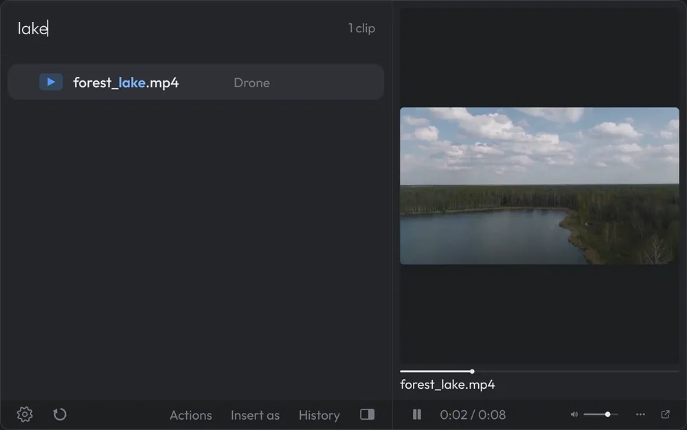

### Every useful tool in one place

Adjustment clips, markers, grabbing a frame, swapping a clip. What you'd normally dig through menus for, you find by typing its name. <kbd>Ctrl</kbd>+<kbd>K</kbd> shows them all, and every script can have its own key in Resolve.

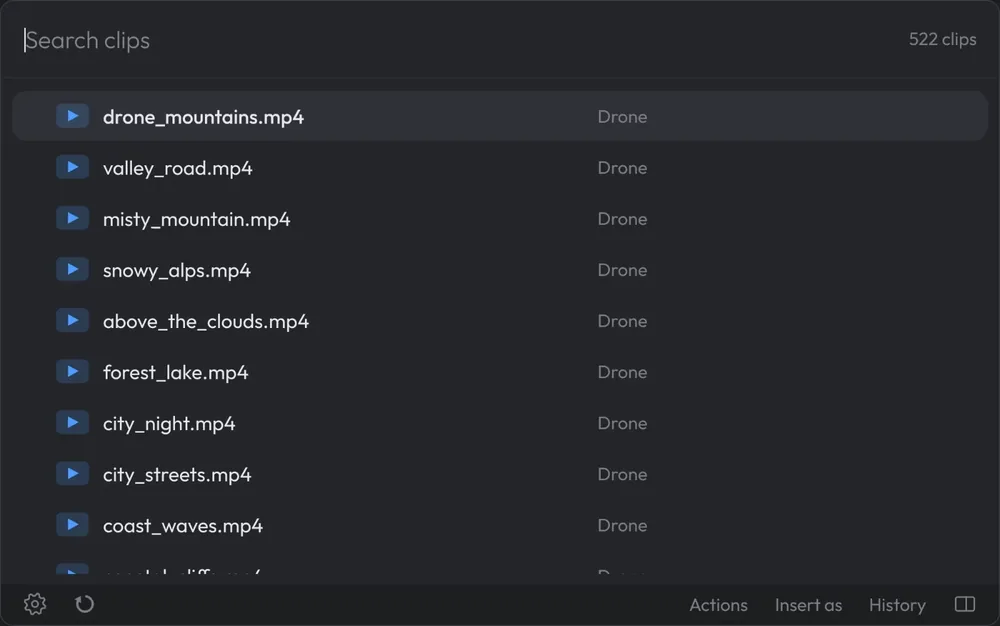

### Choose how clips are inserted

At the playhead, one after another, spaced out or on every marker. <kbd>Ctrl</kbd>+<kbd>I</kbd> sets lengths and where pictures sit in the frame, and shows it on a drawing of your timeline first.

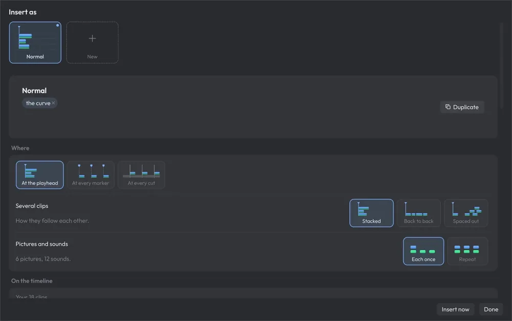

### Fusion expressions

Ready-made expressions and a cheat sheet, right next to your node.

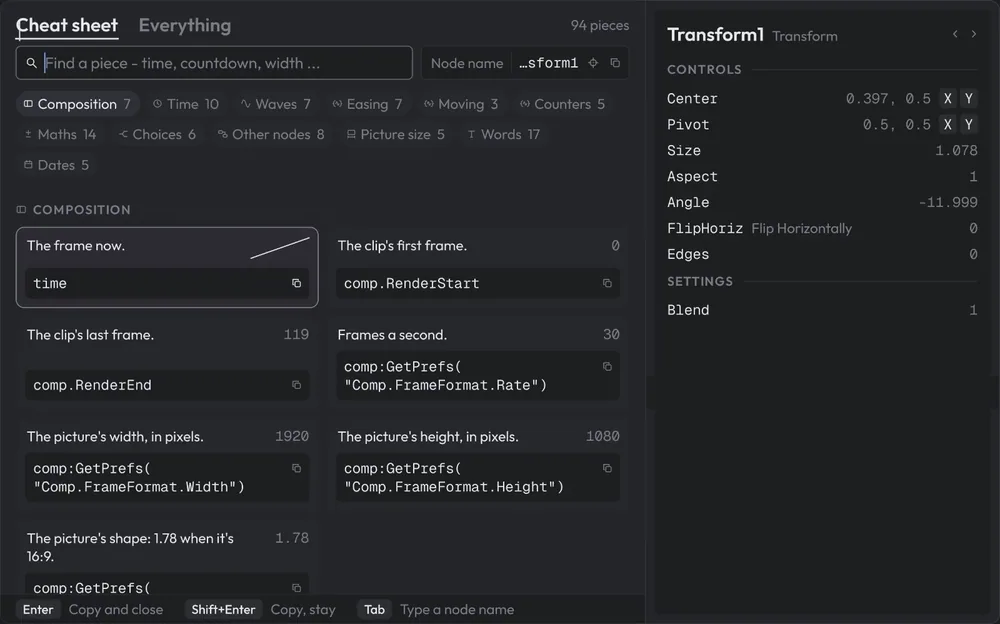

### Swap a clip

Click a clip in Resolve and pick the new one. Same spot, same length.

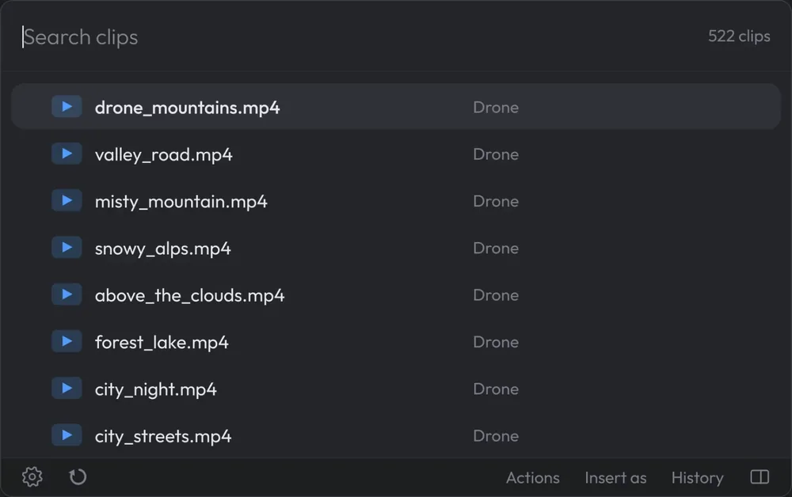

### Sounds like this

Found a sound you like? <kbd>Ctrl</kbd>+<kbd>L</kbd> gets the ones that sound like it.

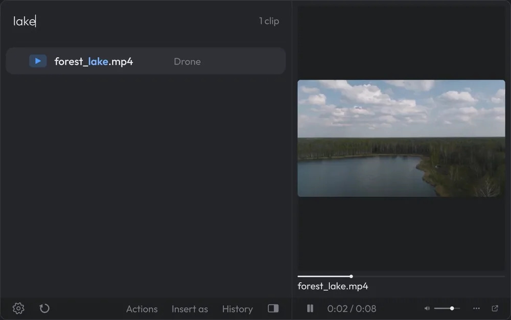

### History

Every insert is kept. Pick an old one and its clips come back, set up the same way.

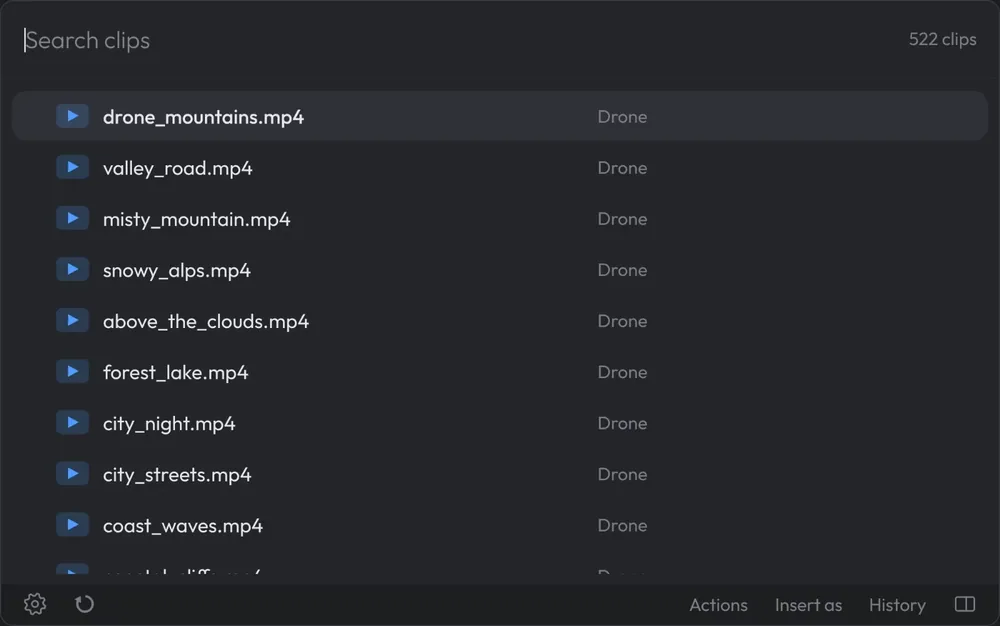

### Make it yours

Pick a theme and drag the edges to any size. Every option shows you what it does.

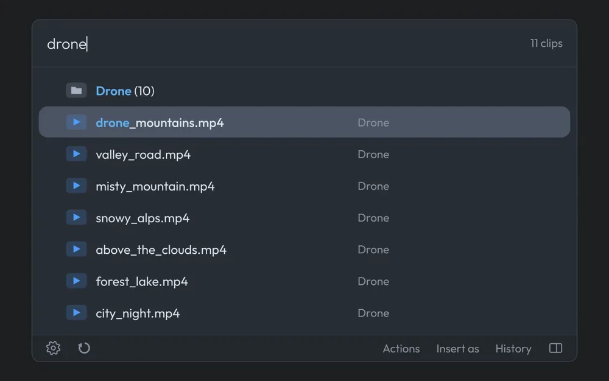

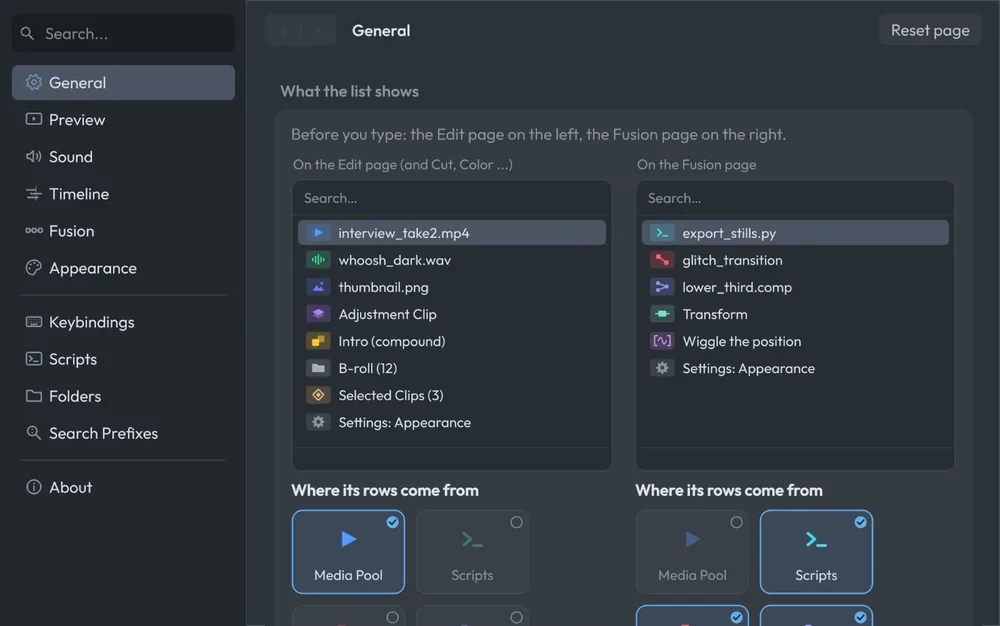

## Why I made it

Searching is faster than looking. It's how I get around my computer, with [Vicinae](https://vicinae.com), and DaVinci Resolve didn't have it. So I added it.

Most editors know the names of the sound effects, nodes and macros they use, or at least some part of the name. The slow part is finding them: the right folder, then the right file among hundreds. With Clipse you type what you're after, and it's there.

## More

- [Guide](docs/guide.md): setting up, keys and common questions
- [Contributing](CONTRIBUTING.md): running it from source

**Privacy:** Clipse checks alnor.store for updates and sends crash logs there, which hold clip names. Both can be turned off in Settings › About. Nothing else leaves your computer unless you send feedback.

**License:** [GPL-3.0](LICENSE). Clipse is an independent tool, not affiliated with Blackmagic Design.
