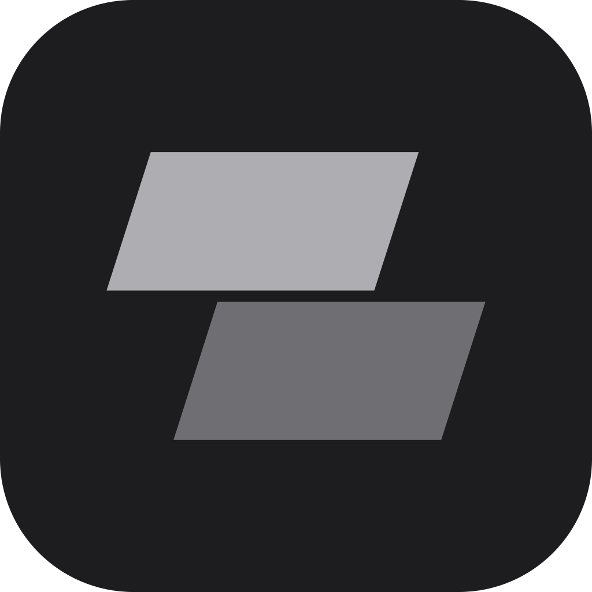

<div align="center">
  
  <h1>Clipse</h1>
  <p>A quick search for DaVinci Resolve Studio.</p>
  <p>
    <a href="#install">Install</a> &nbsp;·&nbsp;
    <a href="docs/guide.md">Guide</a> &nbsp;·&nbsp;
    <a href="https://github.com/alnor0/clipse/releases">Releases</a>
  </p>
</div>

https://github.com/user-attachments/assets/36e35f2f-a0fb-41dd-92a2-e0464f6408cd

<br>

Find it, drop it in, keep editing. Type a few letters, press <kbd>Enter</kbd> and it's on your timeline. Clipse finds your clips, sounds, markers, scripts, macros and Fusion nodes, plays them before you insert them, and lets you decide how they land.

All 23 of my scripts are included, and each can have its own key in Resolve.

Free, with no trial, no key and no account.

## Install

```sh
curl -fsSL https://github.com/alnor0/clipse/releases/latest/download/install.sh | sh
```

Clipse needs DaVinci Resolve Studio, with Preferences › System › General › External scripting using set to Local. Then open it from Workspace › Scripts › !Clipse › Clipse - Open, and give it a key in Resolve's Keyboard Customization.

It's made and tested on Linux. [Mac and Windows builds](https://github.com/alnor0/clipse/releases) are made automatically and have had light to moderate testing, less than Linux.

## Why I made it

Searching is faster than looking. It's how I get around my computer, with [Vicinae](https://vicinae.com) (Linux) or [Raycast](https://www.raycast.com) (Mac and Windows), and DaVinci Resolve didn't have it. So I added it.

Most editors know the names of the sound effects, nodes and macros they use, me included. Or at least some part of the name. The slow part is finding them: the right folder, then the right file among hundreds. That takes too long, and honestly, it's boring.

With Clipse you type what you're after, from the Media Pool or anywhere else, and it's there. It's an add-on to Resolve, but it doesn't feel like one. It fits right in, it's responsive, and it's satisfying to use.

## How it's made

I made Clipse with [Claude Code](https://claude.com/claude-code), and I haven't written any of the code myself. I just had the ideas, and knew what I needed.

The source code is free, so you can do what you want with it. Use it, change it, build on it. And if you can see a way to make Clipse better, I'd love to hear it: [suggest an improvement](https://github.com/alnor0/clipse/issues/new) or send a pull request.

## More

- [Guide](docs/guide.md): setting up, keys and common questions
- [Contributing](CONTRIBUTING.md): running it from source

**Privacy:** Clipse checks alnor.store for updates and sends crash logs there, which hold clip names. Both can be turned off in Settings › About. Nothing else leaves your computer unless you send feedback.

**License:** [GPL-3.0](LICENSE). Clipse is an independent tool, not affiliated with Blackmagic Design.
